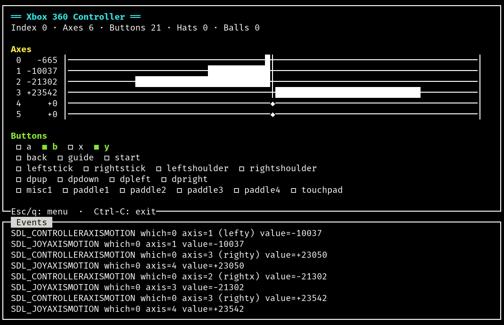

sdl-jstest
==========

`sdl1-jstest`, `sdl2-jstest`, and `sdl3-jstest` are simple programs that lets you find
out how many joysticks SDL, SDL2, or SDL3 detected on your system, how many
axes, buttons, hats and balls they have each. They also lets you test
the joysticks by displaying the events they send or by displaying
their current button, axis, hat or ball state. sdl1-jstest is
especially useful if you want to test your `SDL_LINUX_JOYSTICK`
configuration.

Screenshots
-----------

Requirements
------------

sdl-jstest requires the following packages to build:

* cmake
* libsdl1.2-dev
* libsdl2-dev
* libsdl3-dev
* libncurses5-dev

Compilation
-----------

To compile type:

    mkdir build
    cd build
    cmake ..
    make

To install (optional):

    make install

The `DESTDIR` and `PREFIX` can be configured as follows:

    make install DESTDIR=/tmp/pingus

    cmake .. -DCMAKE_INSTALL_PREFIX:PATH=/usr

Usage
-----

Without options the programs show the terminal UI (ncurses); `--gui`
opens a window instead, which is also the default where there is no
terminal UI (Android, Windows, the browser). The window UI works with a
keyboard, mouse / touch or a gamepad alone: pick a device from the menu,
leave a device view with Escape, the Android Back key or by holding
Select. `--list` prints the devices and exits; `--help` lists everything
else. Each program starts with a report of its environment on stderr
(SDL version and library, video and render drivers, devices and their
mappings), which is the first thing to include in a bug report.

`gamecontrollerdb.txt` is looked up through `--data-dir`, then
`<exe>/../share/sdl-jstest` (Windows: `data\` next to the `.exe`), then
the install prefix; `--show-paths` prints the result.

Nix
---

    nix build                     # all three programs (default package)
    nix run                       # sdl2-jstest; .#sdl1-jstest, .#sdl3-jstest
    nix develop                   # sdl-jstest-{configure,build,run,run-gdb,test}
    nix flake check               # builds everything, runs the checks below

Other targets (Linux hosts):

| Package | What |
|---------|------|
| `sdl-jstest-r36s-portmaster-zip` | PortMaster port for the R36S / ArkOS: one launcher per program, SDL3 and sdl12-compat in `libs/`, SDL2 from the device |
| `sdl2-jstest-android`, `sdl3-jstest-android` | APKs (armeabi-v7a, arm64-v8a, x86_64; Android 5.0+); `nix run .#install-android-sdl3-jstest` installs with adb |
| `sdl-jstest-win64-zip`, `sdl-jstest-win32-zip` | Windows builds with SDL, SDL2 and SDL3 DLLs |
| `sdl-jstest-wasm` | sdl2-jstest and sdl3-jstest as web pages; `nix run .#sdl-jstest-wasm` serves them locally |

The checks need no display or joystick: `--version`, `--help`, the
startup report under the dummy video driver, man pages (`mandoc -T
lint`), REUSE, the desktop files and AppStream metainfo, the install
layout, the R36S binaries' glibc symbol versions and a start under
`qemu-aarch64`, icon and version resources in the `.exe` files, and the
web build's file layout.

Hardware tests, by hand (no check can do them; results in `TODO.md`):

* a gamepad and a joystick in the window UI and the terminal UI (Linux)
* R36S (ArkOS): all three programs through PortMaster, the built-in pad
* Android: both APKs on a device with a gamepad and with touch only
* Windows: all three programs, a gamepad through each SDL version
* browser: both pages with a gamepad (Chromium, Firefox)

